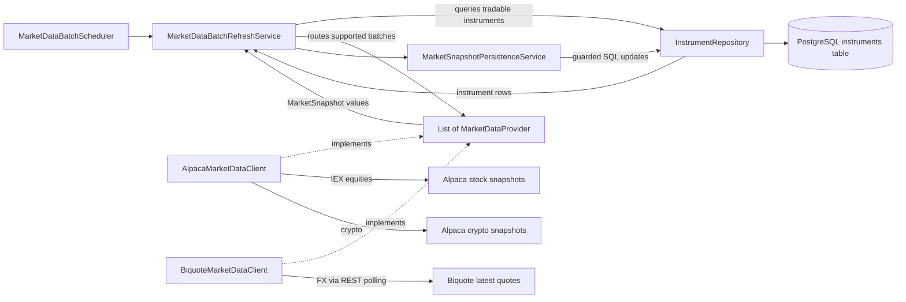

# Market Data Refresh

## Purpose

The market-data refresh stores the latest accepted quote and trade for each supported, tradable instrument in PostgreSQL. Other application flows can use this stored data without making a provider request for every price lookup.

## Refresh flow

`MarketDataProvider` is the provider-neutral boundary. The refresh service injects all implementations as a list and uses each provider's `supports(...)` method for routing. Alpaca handles IEX equities and crypto; Biquote handles the supported FX pairs.

## One refresh cycle

1. When `market-data.refresh.enabled` is `true`, `MarketDataBatchScheduler` starts a cycle on the configured fixed delay and calls `MarketDataBatchRefreshService`.
2. The refresh service loads tradable instruments from `InstrumentRepository` once. For each provider, it checks support, groups duplicate rows by normalized LEAP symbol, sends one supported batch, and persists snapshots against the matching instrument IDs.
3. Alpaca support requires an allowlisted symbol and one of these combinations:

   | Asset class | Currency | Market code | Endpoint |
   |---|---|---|---|
   | `Equity` | `USD` | `IEX` | `/v2/stocks/snapshots` |
   | `Crypto` | `USD` | `CRYPTO` | `/v1beta3/crypto/us/snapshots` |

4. `AlpacaMarketDataClient` separates supported symbols by asset class. A mixed batch produces at most one equity request and one crypto request. The equity request uses the configured IEX feed; the crypto endpoint has no equity feed parameter.
5. `BiquoteMarketDataClient` requires no API key and polls `/api/latest`. Its fixed project catalog is `EUR/USD`, `USD/JPY`, `GBP/USD`, `AUD/USD`, `USD/CAD`, and `USD/INR`. The client translates these LEAP symbols to `EURUSD`, `USDJPY`, `GBPUSD`, `AUDUSD`, `USDCAD`, and `USDINR`, then sends them as repeated `symbols` query parameters in one request.
6. Biquote `bid`, `ask`, and ISO-8601 `timestamp` map to `bidPrice`, `askPrice`, and `quoteAsOf`. The provider's `time` field is MetaTrader-native display text and is not used as the quote timestamp. FX `lastPrice` and `lastTradeAsOf` remain null because Biquote is used as a quote-data source, not as a centralized trade feed. Explicitly stale or closed quotes and invalid individual ticks are skipped without discarding other valid ticks in the batch.
7. Provider responses map into the shared, provider-neutral `MarketSnapshot` representation. The refresh service matches snapshots to instrument rows and passes them to `MarketSnapshotPersistenceService`.
8. The persistence service coordinates writes while `InstrumentRepository` performs the SQL updates on the PostgreSQL `instruments` table.

## What gets persisted

Each instrument can store its latest accepted:

- bid and ask prices with their quote timestamp;
- last price with its last-trade timestamp.

Quotes and trades are updated independently because either group may be absent. Each repository update requires a timestamp strictly newer than the stored value, so an older or duplicate observation cannot overwrite newer market data. The SQL also verifies that the instrument is still tradable before writing.

## Order execution boundary

Market-data retrieval and order execution remain separate. Order validation and execution do not call Alpaca or Biquote directly. They read persisted values from the PostgreSQL `instruments` table: buy execution uses the ask and sell execution uses the bid. Biquote supplies quote data only and is not LEAP's execution venue.
