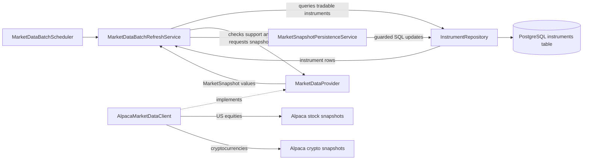

# Market Data Refresh

## Purpose

The market-data refresh stores the latest accepted quote and trade for each supported, tradable instrument in PostgreSQL. Other application flows can use this stored data without making an Alpaca request for every price lookup.

## Refresh flow

`MarketDataProvider` is the provider-neutral boundary. `AlpacaMarketDataClient` is its current implementation.

## One refresh cycle

1. When `market-data.refresh.enabled` is `true`, `MarketDataBatchScheduler` starts a cycle on the configured fixed delay and calls `MarketDataBatchRefreshService`.
2. The refresh service loads tradable instruments from `InstrumentRepository`. It asks the active provider whether each instrument is supported and groups supported rows by normalized symbol.
3. Alpaca support requires an allowlisted symbol and one of these combinations:

   | Asset class | Currency | Market code | Endpoint |
   |---|---|---|---|
   | `Equity` | `USD` | `IEX` | `/v2/stocks/snapshots` |
   | `Crypto` | `USD` | `CRYPTO` | `/v1beta3/crypto/us/snapshots` |

4. `AlpacaMarketDataClient` separates supported symbols by asset class. A mixed batch produces at most one equity request and one crypto request. The equity request uses the configured IEX feed; the crypto endpoint has no equity feed parameter.
5. Responses from both endpoints map into the shared, provider-neutral `MarketSnapshot` representation. The refresh service matches snapshots to instrument rows and passes them to `MarketSnapshotPersistenceService`.
6. The persistence service coordinates writes while `InstrumentRepository` performs the SQL updates on the PostgreSQL `instruments` table.

## What gets persisted

Each instrument can store its latest accepted:

- bid and ask prices with their quote timestamp;
- last price with its last-trade timestamp.

Quotes and trades are updated independently because either group may be absent. Each repository update requires a timestamp strictly newer than the stored value, so an older or duplicate observation cannot overwrite newer market data. The SQL also verifies that the instrument is still tradable before writing.

## Order execution boundary

Market-data retrieval and order execution remain separate. Order validation and execution do not call Alpaca directly. When execution consumes market data, it reads the persisted values from the PostgreSQL `instruments` table.
